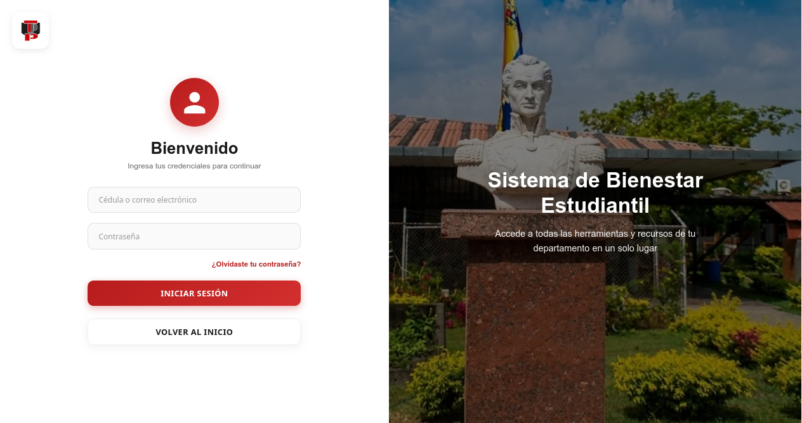
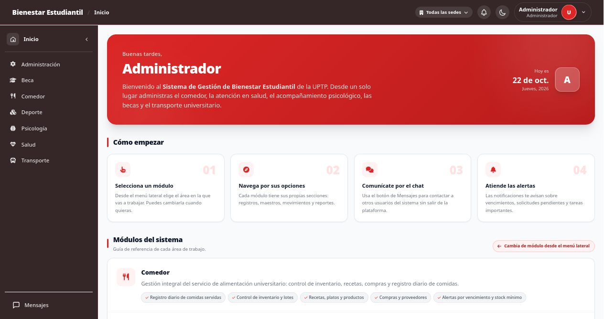
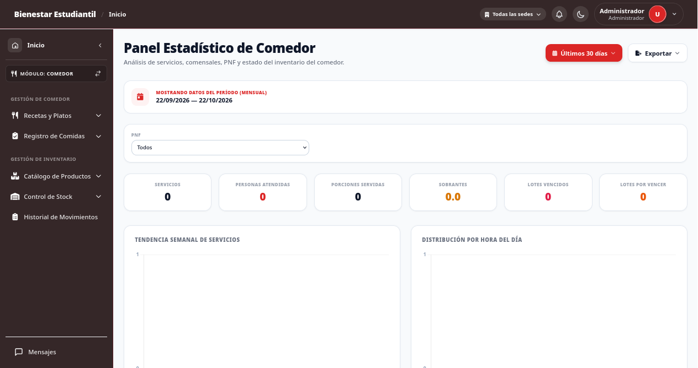
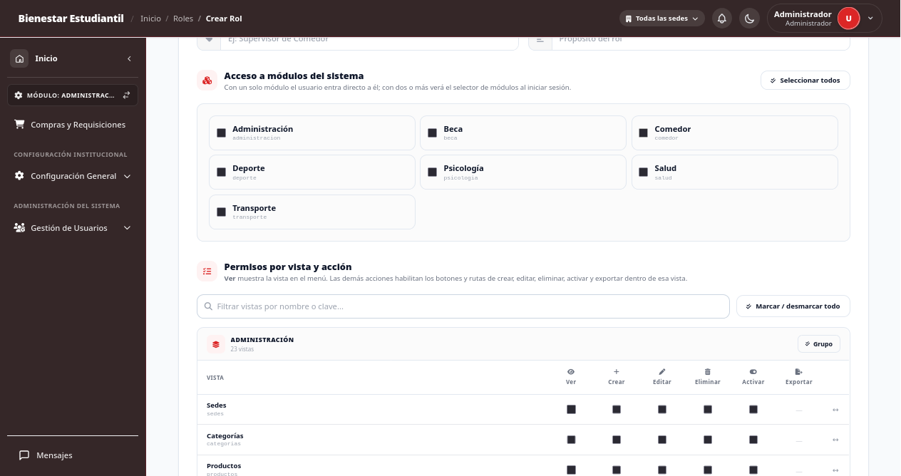
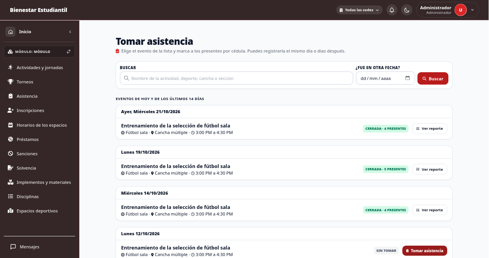
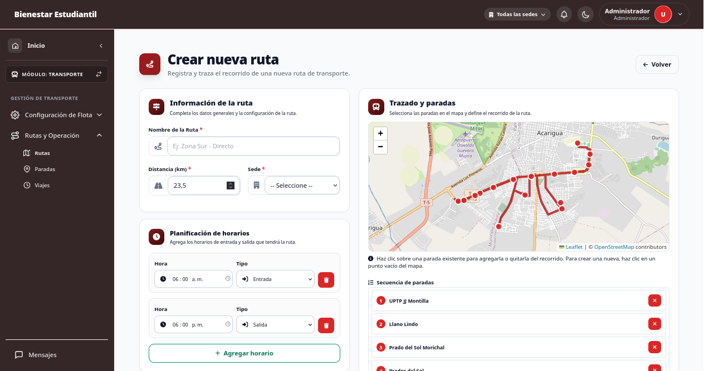
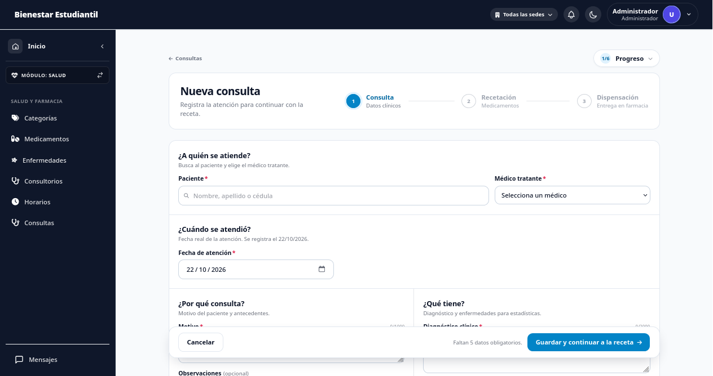
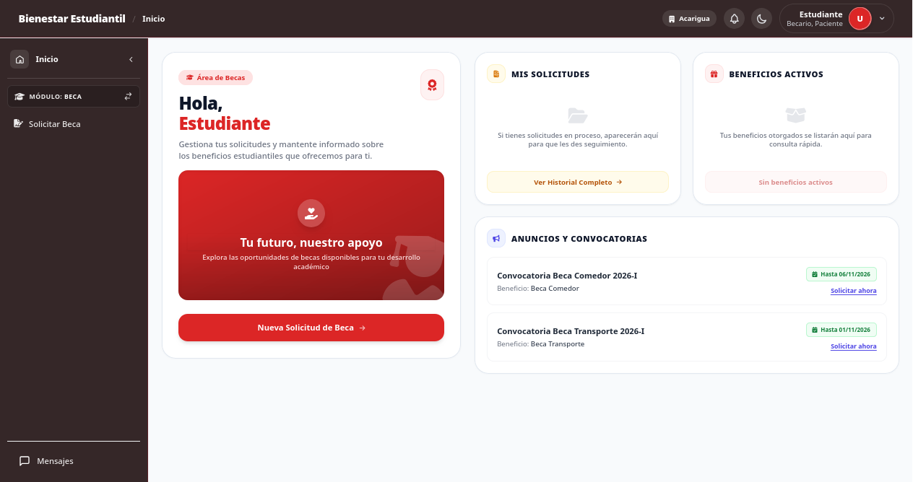
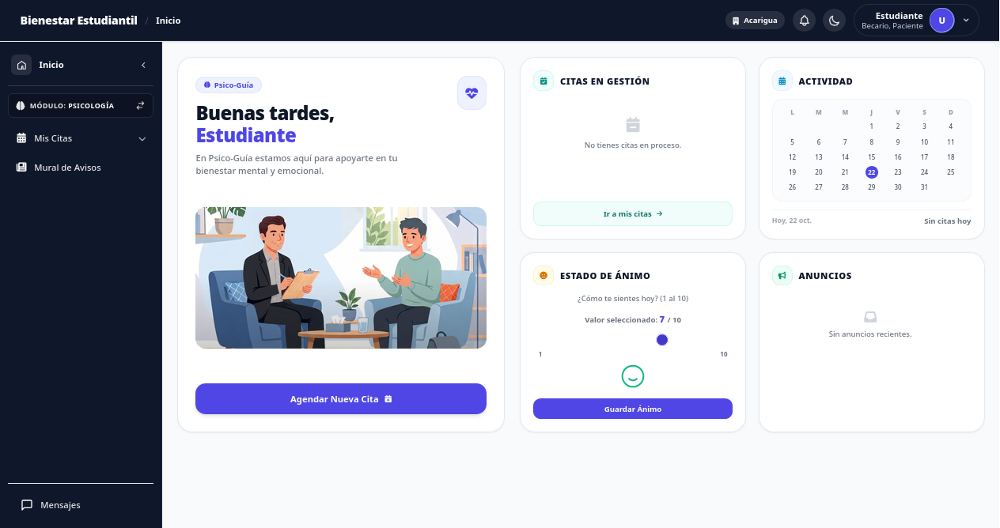

# SIGA — Sistema Integrado de Gestión Universitaria

Plataforma web para el **bienestar estudiantil universitario**. La usa el personal de comedor, salud, psicología, deportes, becas, transporte y administración de una universidad con varias sedes, y la comunidad universitaria (estudiantes, docentes y personal) como pacientes, becarios y participantes.


---

## Contenido

1. [Qué problema resuelve](#qué-problema-resuelve)
2. [Módulos y funcionalidades](#módulos-y-funcionalidades)
3. [Roles, permisos y flujo de acceso](#roles-permisos-y-flujo-de-acceso)
4. [Seguridad](#seguridad)
5. [Arquitectura y decisiones técnicas](#arquitectura-y-decisiones-técnicas)
6. [Instalación con Docker](#instalación-con-docker)
7. [Usuarios de prueba](#usuarios-de-prueba)
8. [Pruebas](#pruebas)
9. [Capturas](#capturas)
10. [Roadmap y pendientes](#roadmap-y-pendientes)
11. [Equipo y licencia](#equipo-y-licencia)

---

## Qué problema resuelve

Las dependencias de bienestar estudiantil suelen trabajar con hojas de cálculo y registros en papel, separados por área y por sede. Así es difícil saber cuánto inventario queda en cada sede, quién recibió un medicamento o un préstamo, o qué hizo cada usuario en el sistema.

SIGA reúne esas áreas en una sola aplicación:

- **Una base de personas compartida:** las personas se identifican por cédula y se importan en lote desde Excel.
- **Un inventario único por lote y por sede:** alimentos, medicamentos, implementos deportivos y material de oficina.
- **Compras centralizadas:** la sede principal compra y la mercancía se reparte entre las sedes.
- **Permisos granulares:** cada rol ve solo las pantallas y acciones que le corresponden.
- **Bitácora de auditoría inmutable:** cada acción queda registrada y no puede alterarse.

Las pantallas están escritas para personal con poca experiencia en computadoras: cada una explica en una línea qué hace, y los estados vacíos dicen qué hacer a continuación.

---

## Módulos y funcionalidades

El sistema se organiza en siete módulos (tabla `modulo`): `comedor`, `salud`, `psicologia`, `deporte`, `beca`, `transporte` y `administracion`. Al entrar, cada usuario ve solo los módulos de sus roles.

### Comedor

Registra los platos servidos en cada comida (desayuno, almuerzo y cena) con sus recetas e ingredientes, y descuenta los insumos del inventario de la sede, empezando por los lotes que vencen primero. El registro diario de comensales se hace por cédula, con raciones y sobrantes, y se exporta a PDF y Excel. El comedor usa las pantallas de inventario (productos, lotes, existencias y movimientos) filtradas por alimentos.

### Salud y farmacia

Gestiona consultorios, horarios de atención (con PDF), enfermedades y el catálogo de medicamentos, con categorías y envases propios. La consulta médica tiene tres pasos: **consulta → receta → dispensación**. Admite varias enfermedades por consulta y un motivo cuando se registra con fecha tardía. La dosis recetada se convierte a la unidad de inventario y se descuenta de la sede. El récipe se genera en PDF, y hay estadísticas por edad, PNF y tipo de persona en PDF y Word.

### Psicología

- **Paciente:** solicita citas en los bloques disponibles, responde contrapropuestas, registra su estado de ánimo diario y participa en un mural de publicaciones.
- **Psicólogo:** gestiona su agenda (aceptar, proponer, posponer, realizar o marcar inasistencia) y lleva **historias clínicas por par paciente-psicólogo**, con plantillas configurables y notas de evolución.
- **Exportaciones:** la cita en PDF, constancias de asistencia, la agenda en PDF, las estadísticas en PDF, Excel y Word, y el expediente completo en PDF, Word o ZIP.

### Deportes

- **Actividades:** son esporádicas (una fecha) o recurrentes (días de la semana dentro de un rango) y pueden tener **bloques simultáneos** de disciplina, espacio y hora. El sistema impide que dos bloques ocupen el mismo espacio a la misma hora.
- **Torneos:** se arman con equipos cuyos integrantes se agregan por cédula. Las actividades no competitivas admiten inscripción individual con cupo opcional.
- **Asistencia:** se toma sobre un evento concreto, también días después. Se marca escribiendo la cédula o pegando una lista; los inscritos no marcados quedan como inasistentes al cerrar. Reabrir una asistencia cerrada queda en la bitácora.
- **Reportes y carteles:** reportes de asistencia por evento y por persona (solo en recurrentes), agenda semanal por espacio y carteles en PDF.

### Implementos y materiales

Una sola vista para los implementos deportivos (balones, mallas, petos) y el material de oficina (marcadores, resmas, lápices). Al registrar un producto primero se elige el tipo, y las categorías y presentaciones se filtran según ese tipo. Todo se cuenta **por unidad**: una compra de 3 cajas de 12 entra al inventario como 36 unidades.

Los **préstamos** sirven para los dos tipos. Cada uno puede tener varios productos y se registra quién entrega y quién recibe. Al devolver se anota lo que volvió bien, lo dañado, lo gastado (material de oficina, sin sanción) y lo perdido. Cada persona puede tener a la vez un préstamo activo de cada tipo.

Los préstamos vencidos se marcan cada hora y generan una sanción. Las sanciones bloquean nuevos préstamos y aparecen en la **constancia de solvencia** (PDF).

### Becas

Gestiona las jornadas de postulación, los beneficios, los criterios y un formulario de preguntas configurable. El estudiante se postula desde el sistema y adjunta su nota certificada, que se guarda en un disco privado. El personal revisa, aprueba o rechaza las solicitudes y avanza el lapso académico.

### Transporte

Gestiona vehículos, marcas, modelos, combustibles, rutas, paradas, viajes, mantenimientos y cargas de combustible. Incluye una **API REST con Laravel Sanctum** para la app móvil del conductor: cartelera de viajes, inicio y fin del viaje, registro GPS, posición y pasajeros. A partir del GPS se calcula un **trazado de referencia por ruta** (algoritmo Douglas-Peucker) y solo se guardan los desvíos. Los registros GPS de más de 30 días se purgan cada día.

### Administración

Reúne los catálogos maestros (sedes, proveedores, PNF, ubicaciones y personas con su perfil) y la importación masiva de personas desde Excel, con generación de cuentas en cola. También contiene usuarios, roles con **matriz de permisos**, permisos por usuario, bitácora de auditoría, bloqueos de seguridad y la gestión de la llave maestra.

### Inventario y compras multisede

- **Inventario:** por lote y por sede, con historial de movimientos (PDF), merma de vencidos y filtros por tipo de producto.
- **Compras:** solo se gestionan desde Administración y solo las crea la **sede principal**. El formulario se adapta al tipo de producto: por kilo o litro en alimentos, por envase en medicamentos y por unidad o caja en implementos y materiales. Además, trae el precio vigente desde `precio_producto`.
- **Recepción de la compra:** la pantalla muestra una **vista previa del reparto**. Cada línea se divide en partes iguales entre las sedes activas, y el sobrante queda en la sede principal.
- **Exportaciones:** las compras se exportan a PDF y pueden enviarse por correo al proveedor.

---

## Roles, permisos y flujo de acceso

### Roles sembrados

| Rol                      | Uso principal                                                                                 |
| ------------------------ | --------------------------------------------------------------------------------------------- |
| Administrador            | Superadministrador: ve todo                                                                   |
| Secretaria De Bienestar  | Superadministradora: ve todo                                                                  |
| Obrero                   | Registro de comida y registro diario del comedor                                              |
| Administrador de Salud   | Catálogos de salud, medicamentos, consultorios y consultas                                    |
| Doctor(a) y Enfermero(a) | Consultas y horarios; medicamentos solo en lectura                                            |
| Psicólogo                | Agenda, historias clínicas, plantillas y mural                                                |
| Paciente                 | Citas psicológicas, mural y estado de ánimo                                                   |
| Administrador de Beca    | Becas, solicitudes y beneficios                                                               |
| Becario                  | Postulación a becas                                                                           |
| Coordinador de Deportes  | Actividades, torneos, asistencia, préstamos, sanciones, solvencia e implementos (sin compras) |

Las cuentas creadas por importación reciben automáticamente el rol Paciente; si la persona es estudiante, también el rol Becario.

### Permisos granulares (vista × acción)

Cada pantalla es una **vista** (catálogo en `config/menu_permissions.php`) y cada vista tiene hasta seis **acciones**: `ver`, `crear`, `editar`, `eliminar`, `activar` y `exportar`. Un permiso es la combinación `vista.accion`.

- **Tablas:** `vista`, `permiso`, `rol_permiso`, `usuario_permiso`, `rol_modulo` y `usuario_modulo`.
- **Permisos por usuario:** a un usuario se le puede **conceder** o **revocar** un permiso puntual con fechas de vigencia (`grant`/`revoke`). Una revocación le gana al permiso del rol.
- **Protección de rutas:** el middleware `CheckMenuPermission` protege todo el grupo `/admin`. Busca la vista de la ruta con `config/menu_routes.php` y deduce la acción por el nombre y el método HTTP (`App\Support\Permisos\ResolutorAccion`). Si la ruta no está registrada, responde 403.
- **Directivas Blade:** `@canMenu`, `@canAction('vista', 'accion')`, `@canRoute('nombre.ruta')` y `@canModule('clave')`. El componente de acciones de las tablas oculta los botones que el usuario no puede usar.
- **Sincronización:** `php artisan permisos:sincronizar` crea las vistas y permisos que falten a partir de la configuración y de las rutas registradas, y otorga todo a los superadmins.

### Flujo de acceso

1. **Inicio de sesión** con correo o cédula. Las cuentas creadas por importación usan la cédula como contraseña inicial y deben cambiarla al entrar.
2. **Llave maestra:**
    - El paso intermedio de llave maestra al iniciar sesión se pide a los usuarios con perfil "Administrador".
    - Las pantallas de configuración (usuarios, roles, permisos, bitácora y bloqueos) piden la llave al rol Administrador una vez por sesión (`RequireMasterKey`).
3. **Selección de módulo:** con un solo módulo permitido, el usuario entra directo. Con varios, elige el módulo desde el inicio o el selector, y puede cambiarlo después desde el menú lateral.
4. **Sede activa:** un usuario normal trabaja siempre con la sede de su persona. Los superadmins pueden cambiar de sede o elegir "Todas".
5. **Recuperación:** la contraseña, y la llave maestra del Administrador, se recuperan respondiendo preguntas de seguridad, con intentos limitados.

---

## Seguridad

- **Bitácora de auditoría (`bitacora_sistema`):**
    - **Qué registra:** cada petición autenticada, cada alta, cambio, borrado y restauración de modelos (con los datos de antes y después, sin campos sensibles), los cambios de permisos y los eventos de seguridad (inicios de sesión, bloqueos, llave maestra, cambios de sede, exportaciones).
    - **Inmutable:** triggers que impiden `UPDATE` y `DELETE`, con versiones para MySQL y PostgreSQL.
    - **Consulta:** pantalla con filtros y detalle; exportación a CSV y PDF.
- **Bloqueos:**
    - **Temporal:** 3 contraseñas, llaves maestras o respuestas de recuperación incorrectas bloquean la cuenta 5 minutos.
    - **Permanente:** 3 bloqueos temporales en 24 horas, o 10 accesos denegados en 10 minutos. El bloqueo permanente revoca los tokens de la API.
    - **Desbloqueo:** desde una pantalla de administración o, en emergencias, con `php artisan seguridad:desbloquear {username}`.
    - **Usuarios inexistentes:** los intentos con usuarios que no existen se limitan por IP con el mismo mensaje, para no revelar qué cuentas existen.
- **Inactividad:** la sesión se cierra tras 15 minutos sin actividad. Un minuto antes aparece un aviso con el botón "Seguir conectado".
- **Cabeceras HTTP:**
    - `X-Frame-Options`, `X-Content-Type-Options`, `Referrer-Policy` y `Permissions-Policy`;
    - Content-Security-Policy en modo informe (`Report-Only`).
- **Confidencialidad de psicología:**
    - Las pantallas clínicas exigen el rol Psicólogo, también a los superadmins.
    - Cada psicólogo ve solo las historias de sus pacientes.
    - El motivo y las notas de las citas, y el contenido de las historias, se guardan cifrados con la llave de la aplicación.
- **Archivos privados:** los documentos de becas y los Excel importados se guardan en `storage/app/private` y solo se descargan a través de rutas que verifican el permiso. `php artisan archivos:migrar-privados` mueve al disco privado los archivos antiguos que quedaron en el disco público.
- **Configuración:** todos los umbrales se ajustan con las variables `SEGURIDAD_*` de `.env.example` (ver `config/seguridad.php`).

---

## Arquitectura y decisiones técnicas

### Stack

| Capa          | Tecnología                                                                              |
| ------------- | --------------------------------------------------------------------------------------- |
| Backend       | Laravel 12, PHP 8.3 (imagen `php:8.3-fpm`), Livewire 3, Laravel Sanctum, Laravel Reverb |
| Frontend      | Blade, Tailwind CSS 3.4, Alpine.js 3, Vite 7, SweetAlert2, Font Awesome                 |
| Documentos    | barryvdh/laravel-dompdf (PDF), maatwebsite/excel (Excel), phpoffice/phpword (Word)      |
| Base de datos | MySQL 8.0 (preparado para migrar a PostgreSQL)                                          |
| Entorno       | Docker Compose: aplicación y MySQL                                                      |

### Estructura de carpetas relevante

```
app/
├── Support/
│   ├── Inventario/   ServicioInventario, RepartoCompra, PrecioVigente, UnidadCompra, FiltroTipoProducto
│   ├── Permisos/     ResolutorAccion, MapaRutas, SincronizadorPermisos, VersionPermisos, PermisoUrl
│   ├── Sedes/        SedeActiva, SedeCompradora
│   ├── Seguridad/    Bloqueos, ProteccionLogin, AccesosDenegados
│   ├── Auditoria/    Bitacora, AuditorModelos, CambiosPermisos
│   ├── Cuentas/      Cedula, CuentasComunidad, ImportadorPersonas
│   └── Deportes/     ServicioActividades, ServicioEventos, ServicioAsistencia, ServicioInscripcion
├── Services/         Lógica de cada módulo (Salud, Deporte, Transporte, becas, Solvencia, …)
├── Traits/           RegistraAutoria, PerteneceASede, PerteneceASedePorRelacion
├── Http/Controllers/ Controladores por módulo (Admin/Configuracion, Api, Auth, beca, Deporte, salud, …)
└── Livewire/         Registro de comida, compras, registro de personas, importación, …
config/               menu_permissions.php, menu_routes.php, permisos.php, seguridad.php
routes/               web.php (+ transporte, psicologia, deportes, beca), api.php, console.php
database/             migrations/ y seeders/
docs/                 Reportes técnicos de cada etapa (seguridad, adaptación al DER, mejoras, deportes y compras)
```

### Decisiones clave

- **Servicio único de inventario (`ServicioInventario`):**
    - Toda entrada, salida, ajuste o transferencia pasa por un solo servicio.
    - Cada operación ocurre en una transacción con bloqueo de filas y actualiza a la vez el lote, la existencia por sede (`inventario_sede_lote`), el total por producto y sede (`inventario_total`) y el movimiento (`movimiento_inventario`).
    - Si no hay existencias suficientes, lanza una excepción en lugar de dejar saldos negativos.
    - `php artisan inventario:recalcular-totales` reconstruye los totales.
- **Multisede:**
    - Los modelos con sede usan los traits `PerteneceASede` o `PerteneceASedePorRelacion`, que aplican un filtro global por la sede activa (`SedeActiva`) y asignan la sede al crear.
    - Un usuario normal no puede ver datos de otra sede. Un superadmin puede elegir una sede o "Todas".
- **Reparto de compras:**
    - La sede principal se marca con `sede.es_principal_sed`; el nombre de la sede no aparece escrito en el código.
    - Al recibir una compra, `RepartoCompra` entrega a cada sede la cantidad dividida entre el número de sedes, redondeada hacia abajo: en unidades enteras para lo contable y con dos decimales para kilos y litros. El sobrante queda en la principal.
    - Todo ocurre en una transacción protegida contra la doble recepción.
- **Nomenclatura del DER:**
    - El esquema sigue el diagrama entidad-relación del proyecto académico: PK `id_xxx`, columnas con sufijo de tres letras y FK `xxx_id`.
    - La macro `$table->auditoria()` agrega `status_id`, `deleted_at`, `created_id` y `updated_id`, y el trait `RegistraAutoria` llena el autor de cada cambio.
    - Los cambios frente al DER están justificados en `docs/`.
- **Compatibilidad con PostgreSQL:**
    - El código usa el query builder sin funciones propias de MySQL.
    - `insertGetId` recibe el nombre de la clave primaria, y las búsquedas nuevas usan `LOWER(...) LIKE`.
    - Los triggers de la bitácora tienen versión para los dos motores.

---

## Instalación con Docker

### Requisitos

- Docker y Docker Compose.
- Puertos libres: `8000` (aplicación), `5731` (Vite), `8080` (Reverb) y `3307` (MySQL desde el host).

### Pasos

1. **Clonar el repositorio y crear el archivo de entorno.**

    ```bash
    git clone <url-del-repositorio>
    cd <carpeta-del-repositorio>
    cp .env.example .env
    ```

    En `.env`, completa `DB_PASSWORD` y `DB_ROOT_PASSWORD` con contraseñas de tu elección. El contenedor de MySQL las usa para crear el usuario y la base.

2. **Construir y levantar los contenedores.**

    ```bash
    docker compose up -d --build
    ```

    Se crean dos contenedores: `SisgestiondeBienestraEstudiantil` (aplicación) y `mysqlbienestraestudiantil` (MySQL 8.0). Al arrancar, la aplicación ejecuta `composer install`, Vite, la cola de trabajos, Reverb y el servidor de Laravel (`docker/start.sh`).

3. **Instalar las dependencias de frontend y reiniciar la aplicación.**

    ```bash
    docker exec SisgestiondeBienestraEstudiantil npm install
    docker compose restart app
    ```

4. **Generar la llave de la aplicación y el enlace de almacenamiento.**

    ```bash
    docker exec SisgestiondeBienestraEstudiantil php artisan key:generate
    docker exec SisgestiondeBienestraEstudiantil php artisan storage:link
    ```

5. **Crear la base de datos con datos de ejemplo y sincronizar los permisos.**

    ```bash
    docker exec SisgestiondeBienestraEstudiantil php artisan migrate:fresh --seed
    docker exec SisgestiondeBienestraEstudiantil php artisan permisos:sincronizar
    ```

    `migrate:fresh` **borra todas las tablas**: úsalo solo en desarrollo. En equipos con disco mecánico puede tardar varios minutos.

6. **Abrir** <http://localhost:8000>.

Todos los comandos `php artisan`, `composer` y de pruebas se ejecutan **dentro del contenedor** con `docker exec SisgestiondeBienestraEstudiantil …`. Desde el host, MySQL responde en el puerto `3307`.

### Tareas programadas

`routes/console.php` programa dos tareas:

- `deportes:marcar-vencidos`, cada hora;
- la purga diaria de los registros GPS antiguos.

`docker/start.sh` no arranca el planificador, así que para que corran hay que ejecutar:

```bash
docker exec SisgestiondeBienestraEstudiantil php artisan schedule:work
```

### Comandos propios útiles

| Comando                            | Qué hace                                                                 |
| ---------------------------------- | ------------------------------------------------------------------------ |
| `permisos:sincronizar`             | Crea las vistas y permisos que falten según la configuración y las rutas |
| `inventario:recalcular-totales`    | Reconstruye `inventario_total` a partir de las existencias por lote      |
| `deportes:marcar-vencidos`         | Marca los préstamos vencidos y aplica la sanción                         |
| `transporte:generar-trazados`      | Genera el trazado de referencia de las rutas que aún no lo tienen        |
| `usuarios:generar-faltantes`       | Crea la cuenta de las personas que no tienen usuario                     |
| `archivos:migrar-privados`         | Mueve al disco privado los documentos que quedaron en el público         |
| `seguridad:desbloquear {username}` | Desbloquea una cuenta en caso de emergencia                              |

---

## Usuarios de prueba

> **Solo para desarrollo.** Estas cuentas las crean los seeders (`database/seeders/PersonaSeeder.php`) con datos ficticios. No deben existir en producción.

| Usuario                         | Rol                        |
| ------------------------------- | -------------------------- |
| `admin@example.com`             | Administrador (superadmin) |
| `psicologa.laura@example.com`   | Psicólogo                  |
| `psicologo.carlos@example.com`  | Psicólogo                  |
| `america@example.com`           | Paciente y Becario         |
| `estudiantebecario@example.com` | Paciente y Becario         |

La contraseña y la llave maestra de desarrollo están definidas en `database/seeders/PersonaSeeder.php`. Los seeders también crean cuentas de personal de salud y una cuenta generada por importación, cuya contraseña inicial es la cédula y que debe cambiarse al entrar.

Datos de ejemplo:

- 4 sedes, con Acarigua como sede principal;
- productos, medicamentos y precios;
- en deportes: una jornada con 3 bloques simultáneos, un entrenamiento recurrente, un torneo con 2 equipos, y préstamos y sanciones de ejemplo.

---

## Pruebas

La suite usa PHPUnit con pruebas de integración (`tests/Feature/Seguridad`). Cubre:

- permisos y botones por permiso;
- multisede;
- bloqueos y bitácora;
- flujos de inventario, salud y compras;
- deportes, implementos y préstamos;
- una prueba de humo que recorre todas las pantallas.

```bash
docker exec SisgestiondeBienestraEstudiantil php artisan test
```

- **Base de pruebas:** las pruebas usan siempre la base `bienestraestudiantil_test`. `phpunit.xml` la fuerza y `tests/TestCase.php` aborta si la base no termina en `_test`. Debe existir y el usuario de `DB_USERNAME` debe tener permisos sobre ella.
- **Reconstrucción automática:** la base se reconstruye y se siembra sola cuando cambian las migraciones o los seeders. Esa primera ejecución tarda bastante más que las siguientes.

---

## Capturas

| Pantalla                   | Captura                                                          |
| -------------------------- | ---------------------------------------------------------------- |
| Inicio de sesión           |                      |
| Selector de módulos        |        |
| Inicio del comedor         |             |
| Matriz de permisos por rol |          |
| Asistencia de deportes     |  |
| Rutas de transporte Estudiantil     |  |
| Consultas de Salud     |  |
| Vista de Becas Estudiante     |  |
| Vista de Psicologia Estudiante     |  |

---

## Equipo y licencia

**Equipo:**

- **EnmaLv** - Lead Developer / DevOps / Fullstack Developer
- **Angel Linarez** (@DevAngelJS) - Fullstack Developer
- **Nohely Sosa** (@Roxanita17) - Fullstack Developer
- **Michele Piñuela** (@Toniielperro) - Fullstack Developer
- **Abdias Campos** (@Abdias-scc) - Fullstack Developer
- **Deiby De Armas** (@deibyjr28-jpg) - Fullstack Developer
